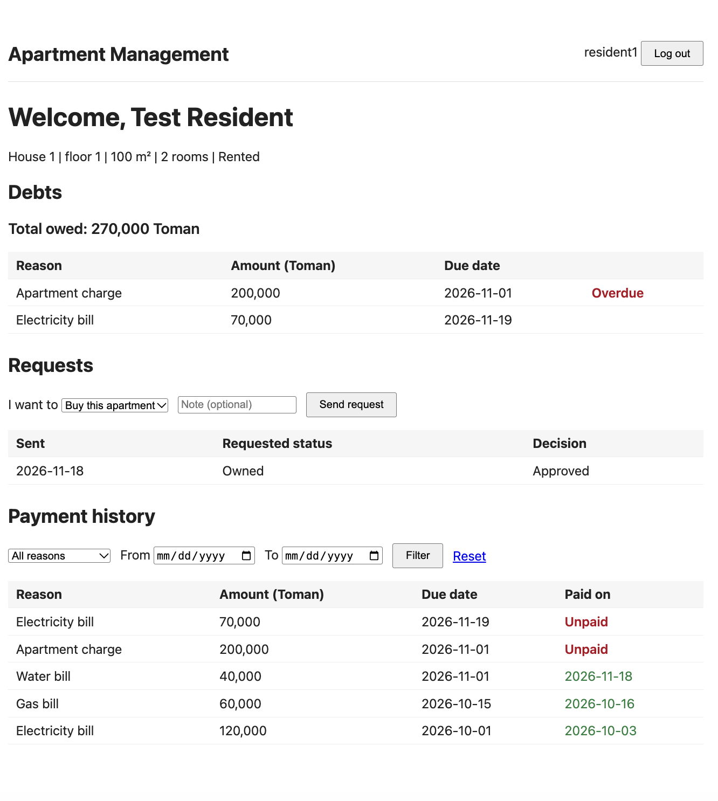
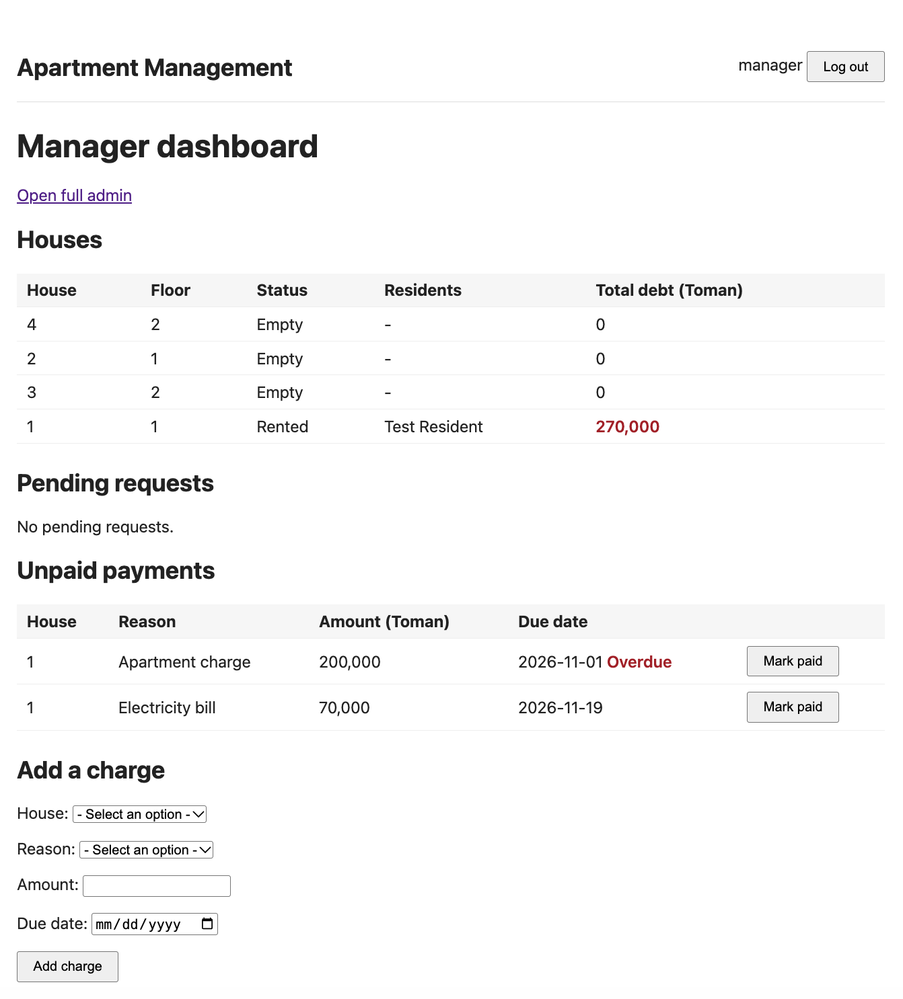

# Apartment Management System


A web application for managing an apartment building, with separate interfaces for **residents** and **managers**. It's a rebuild of a Java console project I wrote in 2024 as a Django web app with a real database, automated tests and a containerised setup.

| Folder | What it is |
|---|---|
| [`Apartment Management System-Django`](Apartment%20Management%20System-Django) | The current version: Django, PostgreSQL, Docker, CI |
| [`Apartment Management System-Java`](Apartment%20Management%20System-Java) | The original Java console project, kept unchanged |

## Screenshots

**Resident dashboard**



**Manager dashboard**



## Features

**Residents**
- Log in and see their house details
- See debts (unpaid payments), the total owed, and which are overdue
- Browse payment history, filtered by reason and date range
- Request a change of house status (for example "Buy this apartment" or "Move out"), with one pending request at a time

**Managers**
- See every house with its residents and total debt
- Add charges to a house, and mark payments as paid
- Approve or reject resident requests (approving updates the house status)
- Use Django's admin for everything else

## Tech stack
- Python 3.12, Django 6.1
- PostgreSQL 16 (Docker) or SQLite (local development)
- Docker and Docker Compose
- GitHub Actions for CI: system check, migration check, tests on PostgreSQL, Docker Compose smoke test

## Run it with Docker
```bash
cd "Apartment Management System-Django"
docker compose up --build
```
In a second terminal, add the demo data:
```bash
docker compose exec web python manage.py seed_demo
```
Then open http://localhost:8000/.

| Role | Username | Password |
|---|---|---|
| Resident | `resident1` | `resident12345` |
| Manager | `manager` | `manager12345` |

These are demo credentials for local use only. The Compose file runs Django's development server and is not a production setup.

## Run it locally (SQLite)
```bash
cd "Apartment Management System-Django"
python3 -m venv .venv
source .venv/bin/activate
pip install -r requirements.txt
python manage.py migrate
python manage.py seed_demo
python manage.py runserver
```

## Run the tests
```bash
python manage.py test
```
The suite has 19 tests covering debt totals, overdue logic, filters, the request rules and manager permissions.

## What changed from the Java version
- Data lives in a database. The Java version hardcoded it in `Main`.
- Debts are computed from payments (a payment with no paid date is a debt). The Java version printed "No debts found!" for everyone.
- Passwords are hashed by Django. The Java version compared plain text.
- Managers have working features, the Java admin menu was empty.
- Automated tests, CI and Docker are new.